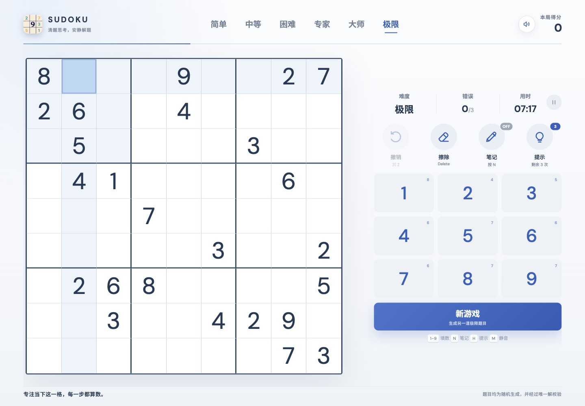

# Sudoku · 数独

**[在线试玩 →](https://f-86.github.io/sudoku/)**



一个使用 React、TypeScript 和 Vite 开发的数独游戏，支持电脑和手机浏览器。

## 玩法

在空格中填入 1–9，让每一行、每一列和每个 3×3 宫内的数字都不重复。选择格子后，点击数字键盘或按 `1–9` 填数；不确定时可开启笔记记录候选数，或使用提示。

## 功能

- 六档难度，随机生成题目并保证唯一解
- 行、列、宫与相同数字高亮，支持笔记、撤销、擦除和每局三次提示
- 计时、得分、错误次数限制与暂停，自动保存当前进度
- 键盘快捷键、响应式手机布局与可记忆的静音开关
- 支持添加到手机主屏幕，首次在线加载完成后可离线游玩

## 游戏截图

以下截图于 2026-10-14 直接截自[在线游戏](https://f-86.github.io/sudoku/)，未修改界面内容；题目为随机生成，每局棋盘会有所不同。主图为桌面视口，手机图为浏览器 390 × 844 视口展示。

**手机端**：棋盘、操作区与单行数字键盘。


**笔记模式**：开启笔记后，可在空格中记录多个候选数。


## 本地启动

```bash
npm install
npm run dev
```

打开终端显示的本地地址即可。手机与电脑连接同一 Wi-Fi 后，也可访问终端显示的 `Network` 地址；需要电脑保持运行。

```bash
npm run lint         # 代码检查
npm run build        # 构建
npm run preview      # 预览构建结果
npm run build:pages  # 构建 GitHub Pages 版本
```

手机安装：使用 Safari（iPhone/iPad）或 Chrome（Android）打开[在线试玩](https://f-86.github.io/sudoku/)，选择“添加到主屏幕”或“安装应用”。安装及离线能力推荐通过 HTTPS 在线地址使用。

快捷键：`1–9` 填数，`N` 笔记，`H` 提示，`Backspace/Delete` 擦除，`Command/Ctrl + Z` 撤销，方向键移动，`P/Space` 暂停或继续，`M` 静音。
